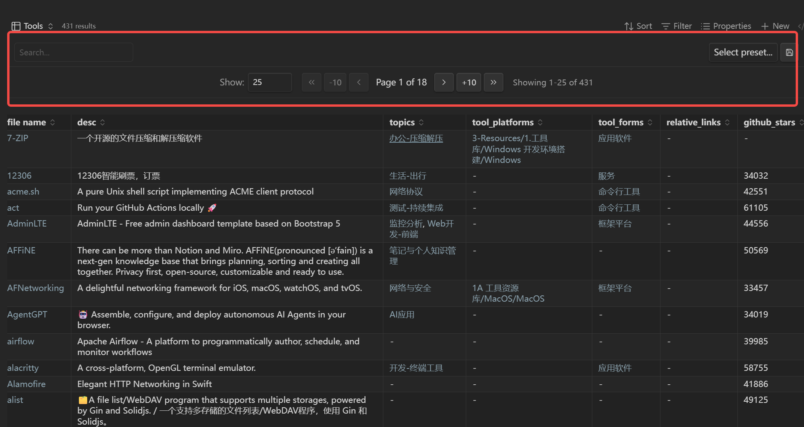

# Bases Paginator

<p align="center">
  <a href="https://community.obsidian.md/plugins/bases-paginator"></a>
  <a href="https://github.com/sean2077/obsidian-bases-paginator/releases/latest"></a>
  <a href="https://github.com/sean2077/obsidian-bases-paginator/actions/workflows/release.yml"></a>
</p>

Bases Paginator is a local, read-only Obsidian view that adds real page navigation to [Bases](https://help.obsidian.md/bases). It stays deliberately small and composes with native Bases instead of replacing its query controls.

Requires Obsidian 1.12.0 or later with the Bases core plugin enabled. Desktop and mobile are supported.
On Obsidian 1.13.0 or later, the plugin's pagination settings also appear in Settings search.



## Why this plugin still exists

Native Bases can limit the number of query results, but a result limit does not provide next/previous pages or access to the remaining results. This plugin keeps that narrow missing capability:

- First, previous, next, and last page navigation, plus direct page-number entry
- Standard and custom page sizes from 1 to 1,000
- Group-aware pagination using the native Bases grouping result, including manual group order and hidden groups on recent Obsidian versions
- Native rendering for links, tags, lists, images, formulas, dates, booleans, and numbers
- Sticky header and top/bottom pagination placement
- Keyboard-accessible controls, screen-reader status, and mobile-sized touch targets

Use the native Bases toolbar for search, filters, named views, sorting, grouping, property visibility/order, display names, and copy/export. The paginated view consumes the resulting rows and groups. Cell editing, selection, summaries, and column resizing remain features of the native Table view.

The [November 2026 compatibility review](./docs/compatibility-review-2026-11-24.md) explains the current product boundary and validation status against Obsidian 1.15.1.

## Important: native result limit

The Obsidian API gives custom views data after the native result limit has already been applied. To paginate the complete filtered result set, remove the Bases result limit or set it high enough for the data you want to page through. The plugin cannot recover rows that the native query omitted.

## Usage

1. Open a `.base` file or embedded Base.
2. Open the view switcher and choose **Paginated table**.
3. Use native Bases controls for search, filters, sorting, grouping, and properties.
4. Choose the page size from the pagination bar or view options.
5. Enter a number in **Go to page** and press Enter to jump directly. Escape cancels an unfinished entry.

Changing the page size keeps the previous first item within the new page. For example, changing from 25 to 10 items while viewing items 26–50 shows items 21–30. Page numbers are session state and do not write to the `.base` file. Page-size preferences are saved to the view.

Hiding every property shows **No properties selected**. Hiding every group shows **No results**. Empty groups have no rows to paginate and are omitted.

The current persisted view options are:

| Key | Values | Purpose |
|---|---|---|
| `pageSize` | `10`, `25`, `50`, `100`, or a custom value entered in the view | Items per page |
| `stickyHeader` | `true` or `false` | Keep column names visible while scrolling |
| `paginationPosition` | `top` or `bottom` | Place the pagination bar above or below the table |

Example:

````markdown
```base
filters:
  and:
    - file.hasTag("task")
views:
  - type: paginated-table
    name: My tasks
    pageSize: "25"
    stickyHeader: true
    paginationPosition: top
```
````

You can embed a named view with `![[MyDatabase.base#My tasks]]`.

## Upgrading from the previous full-table UI

Older releases stored `showSearchBox`, `showFilterBar`, `filterableColumns`, `filterPresets`, and `listRenderMode`. Those keys are now legacy:

- Existing `.base` files remain valid and the plugin leaves the legacy values untouched.
- The legacy values no longer change rendering.
- Recreate saved filter combinations as native named views and use native search, filters, sort, and property controls.

Plugin-wide search/filter defaults are also retained when old `data.json` settings are loaded, so saving current pagination defaults is non-destructive.

## Limitations

- The view cannot edit cells, create/delete rows, or change source notes. Use the native Table view or edit the note.
- Pagination covers only rows supplied by the Bases API after native filters, sort, and limit.
- Native Table-only interactions such as multi-cell selection, paste, summaries, column resizing, and collapsed-group state are not reimplemented.
- Empty placeholder groups created in the native Group menu are not displayed by this row-based view.

## Performance expectations

Only the current page is rendered. Group offsets are indexed when Bases supplies updated data, so ordinary page navigation does not traverse every group again. Large page sizes still cost more to render, particularly with many columns, images, or formulas.

Pagination bounds this view's DOM work. It does not reduce the cost of native query evaluation, sorting, or formulas, and it does not imply that this custom view is faster than Obsidian's own views. Keep the page size modest for comfortable browsing on mobile.

## Installation

### Community plugins

1. Open **Settings → Community plugins**.
2. Search for **Bases Paginator**.
3. Select **Install**, then **Enable**.

### BRAT

Add `https://github.com/sean2077/obsidian-bases-paginator` in BRAT, then enable the plugin.

### Manual

Copy `main.js`, `manifest.json`, and `styles.css` from the latest release into:

```text
<Vault>/.obsidian/plugins/bases-paginator/
```

Reload Obsidian and enable the plugin under Community plugins.

## Development

See the [development guide](./docs/development.md) for commands, architecture, compatibility decisions, verification, and release details.

## License

See [LICENSE](./LICENSE).
